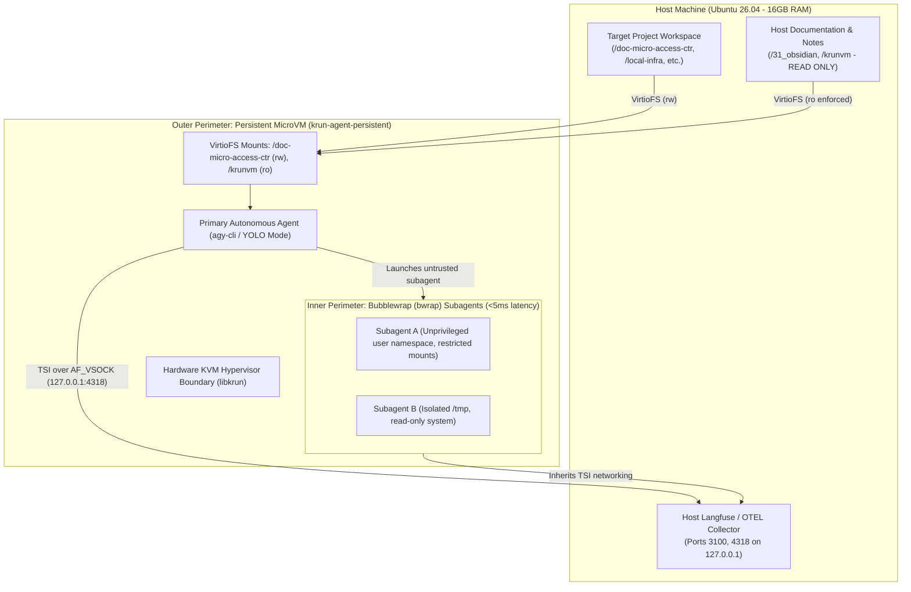

# krunvm MicroVM Sandbox & In-VM Bubblewrap Orchestration

[](https://releases.ubuntu.com/)
[](https://github.com/libkrun/libkrun)
[](https://docs.astral.sh/uv/)
[](https://antigravity.google/)
[](https://langfuse.com/)

A high-performance, hardened **microVM orchestration framework** designed for autonomous AI coding agents on Ubuntu workstations (optimized for 16 GB RAM / 8-core hardware).

Powered by [`libkrun`](https://github.com/libkrun/libkrun) and [`krunvm`](https://github.com/libkrun/krunvm), this repository delivers a **Hardened Two-Tier Isolation Architecture**:
1. **Outer Hypervisor Perimeter:** A single persistent, stateful microVM (`krun-agent-persistent`) providing a hardware-isolated KVM hypervisor boundary around the entire agent runtime.
2. **Inner Process Perimeter:** Zero-overhead subagent isolation via Antigravity CLI's native **Bubblewrap (`bwrap`)** unprivileged user namespaces (<5ms cold start, 0 MB memory overhead).

---

## Architecture & System Flow



---

## Why krunvm + Bubblewrap for Agentic Workloads?

| Dimension | Canonical Multipass | Nested MicroVMs | krunvm + In-VM Bubblewrap (This Repo) |
| :--- | :--- | :--- | :--- |
| **Boot Latency** | 15–30 seconds | ~100 ms per subagent | **< 100 ms** (Outer VM) / **< 5 ms** (`bwrap` subagent) |
| **Memory Allocation** | Static reservation (e.g. 2GB pinned) | Multiplied per VM instance | **Dynamic in-process (yields back to host)** |
| **Idle RAM Overhead** | ~350–600 MB (systemd, snapd) | ~50 MB per nested VM | **~30–50 MB total** (0 MB for bwrap subagents) |
| **Outer Boundary** | KVM / Full hypervisor | KVM | **Hardware KVM hypervisor boundary** |
| **Subagent Sandboxing** | Slow VM cloning | Nested hypervisor overhead | **Native unprivileged user namespaces (`bwrap`)** |
| **Networking** | Bridged / NAT subnet | Complex nested bridges | **Transparent Socket Impersonation (TSI)** |

---

## Repository Structure

```text
├── .agents/
│   ├── hooks.json                     # Antigravity CLI post-tool telemetry hooks
│   └── plans/                         # Execution logs & decision manifests
├── configs/
│   └── Containerfile                  # OCI base image (Ubuntu + uv + agy + bwrap + podman)
├── docs/
│   ├── multipass-vs-krunvm-bwrap-comparison.md # Technical trade-off matrix & bwrap architecture
│   └── plans/
│       └── krunvm-implementation-plan.md # Full architecture specification
├── scripts/
│   ├── build_image.sh                 # Builds localhost/krun-agent-sandbox:latest via Buildah
│   ├── build_krunvm_host.sh           # Builds libkrunfw, libkrun, and krunvm from source
│   ├── check_prerequisites.sh         # Pre-flight host validation script
│   ├── export_agy_otel.sh             # Antigravity CLI OpenTelemetry exporter hook
│   ├── export_agy_otel_to_langfuse.py # OTLP HTTP trace exporter
│   ├── get_active_agy_session.sh      # Active Antigravity session discovery helper
│   ├── test_connectivity.sh           # In-microVM network & Langfuse connectivity test
│   ├── test_containers.sh             # Nested Docker / Podman container validation
│   ├── test_env_verification.sh       # Full verification suite (symlinks, ro-mounts, telemetry)
│   └── test_smoke.sh                  # End-to-end telemetry pipeline validation
├── .env.host                          # SSOT host control plane configuration (git ignored)
├── .env                               # Active host environment configuration (git ignored)
├── .env.example                       # Canonical orchestrator configuration template
├── .env.sandbox                       # Guest agent secrets template (git ignored)
├── .env.sandbox.example               # Guest agent secrets template
├── .gitignore                         # Strict exclusion for secrets, venvs, and build artifacts
├── pyproject.toml                     # Python dev dependencies & linter standards
├── run_sandbox.sh                     # Interactive persistent sandbox launcher (YOLO mode)
└── setup.sh                           # Idempotent provisioning & lifecycle engine
```

---

## Quickstart Guide

### 1. Host Prerequisites
Run the pre-flight check to verify your Linux KVM permissions and build tools:
```bash
./scripts/check_prerequisites.sh
```

If missing system dependencies are reported, install them:
```bash
sudo apt update && sudo apt install -y \
    build-essential libelf-dev libssl-dev pkg-config flex bison buildah python3-pyelftools
```

### 2. Build krunvm for Your Host
Compile `libkrunfw`, `libkrun`, and `krunvm` from source directly into `~/.local`:
```bash
./scripts/build_krunvm_host.sh
```

Ensure your `~/.bashrc` includes the installation prefix:
```bash
export PATH="$HOME/.local/bin:$PATH"
export LD_LIBRARY_PATH="$HOME/.local/lib:$LD_LIBRARY_PATH"
```

### 3. Build the Base OCI Image
Build the hardened agent sandbox base image via Buildah:
```bash
./scripts/build_image.sh
```

### 4. Configure & Provision the Environment
Copy the environment template and run the setup engine:
```bash
cp .env.example .env.host
cp .env.sandbox.example .env.sandbox

./setup.sh
```

---

## Daily Operations Playbook

### Interactive Persistent Sandbox (YOLO Mode)
Attach an interactive bash session into your primary development sandbox:
```bash
./run_sandbox.sh
```

### Subagent Sandboxing via Antigravity Bubblewrap
Inside the microVM, `agy` can run subagents under unprivileged user namespaces:
```bash
# Launch Antigravity CLI with native Bubblewrap sandbox active:
agy --sandbox

# Direct Bubblewrap one-shot execution:
bwrap --ro-bind / / --dev /dev --proc /proc --bind /doc-micro-access-ctr /doc-micro-access-ctr python3 untrusted_task.py
```

### Test Telemetry & Langfuse Connectivity
Verify that in-microVM requests route over TSI to host Langfuse (`:3100`) and OpenTelemetry (`:4318`):
```bash
./run_sandbox.sh test_connectivity
```

---

## Security & Blast Radius Controls

1. **Hardware Virtualization:** MicroVM processes run under Linux KVM with a dedicated minimal kernel (`libkrunfw`), eliminating container-breakout risks to the host kernel.
2. **Mount Guardrails & Read-Only Protection:** `setup.sh` strictly forbids mounting host root (`/`), `/home`, or `$HOME`. Sensitive repositories (`/krunvm`, notes) are enforced as **Read-Only (`:ro`)** via Linux kernel bind-remounts, preventing the agent from modifying its own harness.
3. **Decoupled Secrets:** Master host credentials remain on the host; only scoped agent tokens defined in `.env.sandbox` are injected into `/home/ubuntu/.gemini/antigravity-cli/.env`.
4. **Zero-Overhead In-VM Subagents:** Subagents spawned by `agy` operate within `bwrap` unprivileged user namespaces, preventing rogue subagents from corrupting the primary agent's files or processes.
