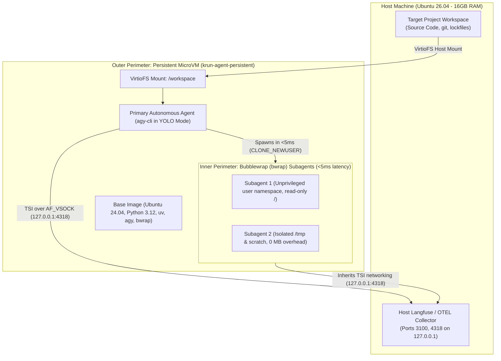

# krunvm MicroVM Sandbox & Subagent Orchestration

[](https://releases.ubuntu.com/)
[](https://github.com/libkrun/libkrun)
[](https://docs.astral.sh/uv/)
[](https://antigravity.google/)
[](https://langfuse.com/)

A high-performance, hardened **microVM orchestration framework** designed for autonomous AI coding agents on Ubuntu workstations (optimized for 16 GB RAM / 8-core hardware).

Powered by [`libkrun`](https://github.com/libkrun/libkrun), [`krunvm`](https://github.com/libkrun/krunvm), and [`bubblewrap` (`bwrap`)](https://github.com/containers/bubblewrap), this repository delivers a **Two-Tier Defense-in-Depth Architecture**:
1. **Outer Perimeter — Persistent MicroVM (`krun-agent-persistent`):** A long-lived, stateful microVM providing a hardware-isolated KVM hypervisor boundary around the primary autonomous agent (YOLO mode), native `ext4` Python virtualenv (`/var/venv`), and workspace mounts.
2. **Inner Perimeter — In-VM Bubblewrap (`bwrap`) Subagents:** Zero-overhead subagent isolation inside the microVM via Antigravity CLI's native `bwrap` unprivileged user namespaces (`< 5 ms` cold start, `0 MB` extra RAM overhead), with optional standalone disposable microVMs (`launch_subagent_microvm.sh`) when full kernel-level task separation is required.

---

## Architecture & System Flow



---

## Why krunvm + Bubblewrap for Agentic Workloads?

| Dimension | Canonical Multipass | Standard Docker / Podman | krunvm + In-VM Bubblewrap (This Repo) |
| :--- | :--- | :--- | :--- |
| **Boot Latency** | 15–30 seconds | ~1 second | **< 100 ms** (Outer VM) / **< 5 ms** (`bwrap` subagent) |
| **Memory Allocation** | Static reservation (e.g. 2GB pinned) | Shared host memory | **Dynamic in-process (yields back to host)** |
| **Idle Overhead** | ~350–600 MB (systemd, snapd) | ~50 MB (daemon overhead) | **~30–50 MB total** (0 MB for `bwrap` subagents) |
| **Isolation Boundary** | KVM / Full hypervisor | Shared Linux kernel | **Hardware KVM outer + `bwrap` namespace inner** |
| **Subagent Spawning** | Slow VM cloning | Container escapes risk host | **Instantaneous `bwrap` user namespaces (`< 5 ms`)** |
| **Networking** | Bridged / NAT subnet | Virtual bridge (docker0) | **Transparent Socket Impersonation (TSI)** |

---

## Repository Structure

```text
├── .agents/
│   ├── hooks.json                     # Antigravity CLI post-tool telemetry hooks
│   └── plans/                         # Execution logs & decision manifests
├── configs/
│   └── Containerfile                  # OCI base image (Ubuntu + uv + agy + bwrap + OTEL)
├── docs/
│   ├── multipass-vs-krunvm-bwrap-comparison.md # Technical trade-off matrix & bwrap architecture
│   └── plans/
│       └── krunvm-implementation-plan.md # Full architecture specification
├── scripts/
│   ├── build_image.sh                 # Builds localhost/krun-agent-sandbox:latest via Buildah
│   ├── build_krunvm_host.sh           # Builds libkrunfw, libkrun, and krunvm from source
│   ├── check_prerequisites.sh         # Pre-flight host validation script
│   ├── export_agy_otel.sh             # Antigravity CLI OpenTelemetry exporter hook
│   ├── export_agy_otel_to_langfuse.py # OTLP HTTP trace exporter
│   ├── get_active_agy_session.sh      # Active Antigravity session discovery helper
│   ├── launch_subagent_microvm.sh     # Optional standalone disposable microVM launcher
│   ├── test_connectivity.sh           # In-microVM network & Langfuse connectivity test
│   ├── test_containers.sh             # Nested container / namespace validation script
│   └── test_smoke.sh                  # End-to-end telemetry pipeline validation
├── .env.example                       # Canonical orchestrator configuration template
├── .env.sandbox.example               # Guest agent secrets template
├── .gitignore                         # Strict exclusion for secrets, venvs, and build artifacts
├── pyproject.toml                     # Python dev dependencies & linter standards
├── run_sandbox.sh                     # Interactive persistent sandbox launcher (YOLO mode)
└── setup.sh                           # Idempotent provisioning & lifecycle engine
```

---

## Quickstart Guide

### 1. Host Prerequisites
Run the pre-flight check to verify your Linux KVM permissions and build tools:
```bash
./scripts/check_prerequisites.sh
```

If missing system dependencies are reported, install them:
```bash
sudo apt update && sudo apt install -y \
    build-essential libelf-dev libssl-dev pkg-config flex bison buildah python3-pyelftools
```

### 2. Build krunvm for Your Host
Compile `libkrunfw`, `libkrun`, and `krunvm` from source directly into `~/.local`:
```bash
./scripts/build_krunvm_host.sh
```

Ensure your `~/.bashrc` includes the installation prefix:
```bash
export PATH="$HOME/.local/bin:$PATH"
export LD_LIBRARY_PATH="$HOME/.local/lib:$LD_LIBRARY_PATH"
```

### 3. Build the Base OCI Image
Build the hardened agent sandbox base image via Buildah:
```bash
./scripts/build_image.sh
```

### 4. Configure & Provision the Environment
Copy the environment template and run the setup engine:
```bash
cp .env.example .env
cp .env.sandbox.example .env.sandbox

./setup.sh
```

---

## Daily Operations Playbook

### Interactive Persistent Sandbox (YOLO Mode)
Attach an interactive bash session into your primary development sandbox:
```bash
./run_sandbox.sh
```

### Subagent Sandboxing via Antigravity Bubblewrap (`bwrap`)
Inside the persistent microVM, `agy` isolates subagents under unprivileged Linux user namespaces (`< 5 ms` startup, `0 MB` RAM overhead):
```bash
# Launch Antigravity CLI with native Bubblewrap sandboxing inside the microVM:
agy --sandbox

# Direct Bubblewrap one-shot execution from the host into the persistent microVM:
./run_sandbox.sh bwrap --ro-bind / / --dev /dev --proc /proc --tmpfs /tmp /bin/echo "Hello from bwrap inside krunvm!"
```

### Optional: Launch a Standalone Ephemeral MicroVM Subagent
For heavy or untrusted tasks requiring a dedicated disposable kernel and rootfs (`< 100 ms` cold start):
```bash
# Execute a one-shot Python task inside an isolated microVM:
./scripts/launch_subagent_microvm.sh /path/to/scratch python3 -c "print('Hello from disposable microVM')"

# Open an interactive disposable subagent shell:
./scripts/launch_subagent_microvm.sh
```

### Test Telemetry & Langfuse Connectivity
Verify that in-microVM requests route over TSI to host Langfuse (`:3100`) and OpenTelemetry (`:4318`):
```bash
./run_sandbox.sh test_connectivity
```

---

## Security & Blast Radius Controls

1. **Hardware Virtualization (Outer Perimeter):** MicroVM processes run under Linux KVM with a dedicated minimal kernel (`libkrunfw`), eliminating container-breakout risks to the host kernel.
2. **Zero-Overhead Namespace Isolation (Inner Perimeter):** Subagents spawned by `agy` execute inside `bwrap` unprivileged user namespaces (`CLONE_NEWUSER`), preventing subagents from corrupting the primary agent's virtual environment, mounts, or secrets.
3. **Mount Guardrails:** `setup.sh` strictly forbids mounting host root (`/`), `/home`, or `$HOME`. Only explicit project subfolders are shared.
4. **Decoupled Secrets:** Master host credentials remain on the host; only scoped agent tokens defined in `.env.sandbox` are exposed to the guest.
