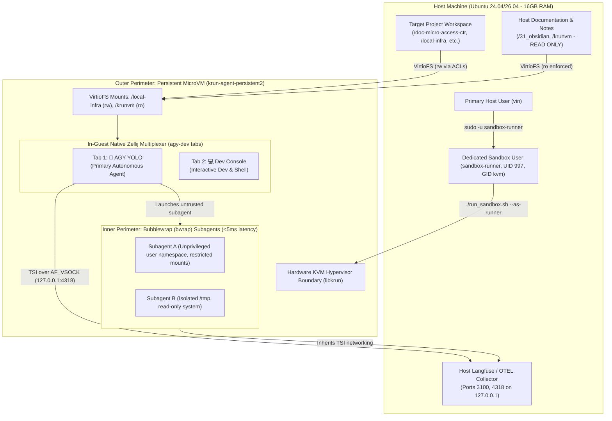
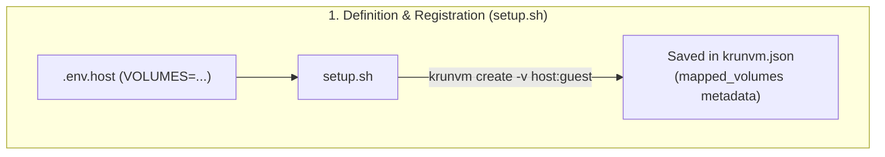
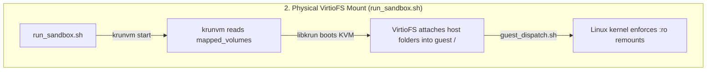

# krunvm MicroVM Sandbox & In-VM Bubblewrap Orchestration

[](https://releases.ubuntu.com/)
[](https://github.com/libkrun/libkrun)
[](https://docs.astral.sh/uv/)
[](https://antigravity.google/)
[](https://langfuse.com/)

A high-performance, hardened **microVM orchestration framework** designed for autonomous AI coding agents on Ubuntu workstations (optimized for 16 GB RAM / 8-core hardware).

Powered by [`libkrun`](https://github.com/libkrun/libkrun) and [`krunvm`](https://github.com/libkrun/krunvm), this repository delivers a **Hardened Two-Tier Isolation Architecture**:
1. **Outer Hypervisor Perimeter:** A single persistent, stateful microVM (`krun-agent-persistent`) providing a hardware-isolated KVM hypervisor boundary around the entire agent runtime.
2. **Inner Process Perimeter:** Zero-overhead subagent isolation via Antigravity CLI's native **Bubblewrap (`bwrap`)** unprivileged user namespaces (<5ms cold start, 0 MB memory overhead).

---

## Architecture & System Flow



---

## Why krunvm + Bubblewrap for Agentic Workloads?

| Dimension | Canonical Multipass | Nested MicroVMs | krunvm + In-VM Bubblewrap (This Repo) |
| :--- | :--- | :--- | :--- |
| **Boot Latency** | 15–30 seconds | ~100 ms per subagent | **< 100 ms** (Outer VM) / **< 5 ms** (`bwrap` subagent) |
| **Memory Allocation** | Static reservation (e.g. 2GB pinned) | Multiplied per VM instance | **Dynamic in-process (yields back to host)** |
| **Idle RAM Overhead** | ~350–600 MB (systemd, snapd) | ~50 MB per nested VM | **~30–50 MB total** (0 MB for bwrap subagents) |
| **Outer Boundary** | KVM / Full hypervisor | KVM | **Hardware KVM hypervisor boundary** |
| **Subagent Sandboxing** | Slow VM cloning | Nested hypervisor overhead | **Native unprivileged user namespaces (`bwrap`)** |
| **Networking** | Bridged / NAT subnet | Complex nested bridges | **Transparent Socket Impersonation (TSI)** |

---

## Key Architectural Updates & Specifications

1. **Single Parent MicroVM Architecture:**
   * Only one persistent microVM (`krun-agent-persistent`) is provisioned and managed by `krunvm`.
   * Nested or ephemeral microVM subagents are explicitly disabled to eliminate nested KVM virtualization tax, guest rootfs duplication, and `flock` VM contention.

2. **In-VM Bubblewrap (`bwrap`) Subagent Isolation:**
   * Autonomous subagents launched by `agy-cli` execute inside native unprivileged Linux user namespaces via `bwrap`.
   * **Latency:** < 5 ms spawn time.
   * **Memory:** 0 MB baseline overhead (shares guest kernel page cache).
   * **Isolation:** Unprivileged user namespace (`CLONE_NEWUSER`), isolated `/tmp`, restricted device access, and selective `--ro-bind` / `--bind` mounts.

3. **Hierarchical Decoupled Environment (Multipass Parity):**
   * **`.env.host` / `.env`:** Host control plane SSOT (VM sizing, ports, host volume definitions). Ignored by git to avoid path and secret leakage.
   * **`.env.example`:** Tracked sanitized host template.
   * **`.env.sandbox`:** Decoupled guest-only secrets (Langfuse keys, OTLP endpoint) injected into `/home/ubuntu/.gemini/antigravity-cli/.env`. Ignored by git.
   * **`.env.sandbox.example`:** Tracked sanitized guest template.

4. **Single-Depth Path Normalization & Symlinks:**
   * `krunvm` strictly requires guest mount paths to be single-depth root children (e.g. `/doc-micro-access-ctr`).
   * `setup.sh` automatically normalizes `/home/ubuntu/<name>` paths to direct root mounts on the hypervisor, while generating `/home/ubuntu/<name>` compatibility symlinks inside the guest.

5. **Read-Only (`:ro`) Volume Protection:**
   * To prevent an autonomous agent in YOLO mode from mutating its own orchestrator or notes, sensitive volumes (`/krunvm:ro`, `/31_obsidian:ro`) are enforced via Linux kernel bind-remounts:
     ```bash
     mount --bind /krunvm /krunvm
     mount -o remount,ro,bind /krunvm
     ```
   * Enforced automatically via `/usr/local/bin/enforce-mounts.sh` hooked into bash startup.

6. **Dedicated Host Identity (`sandbox-runner`):**
   * Eliminates running microVM hypervisor processes under the primary developer user (`vin`, UID 1000).
   * MicroVM processes, container layers, and KVM access run under the unprivileged system user `sandbox-runner` (UID 997, GID `kvm`).
   * POSIX ACLs (`setfacl`) grant least-privilege read-write access to target project workspaces while keeping developer secrets and SSH keys isolated.

7. **Native In-Guest Zellij Multiplexing:**
   * Static [Zellij v0.45.1](https://github.com/zellij-org/zellij/releases) and tabbed layout `agy-dev` are baked into the base image.
   * On interactive connection, Zellij automatically opens dedicated full-screen tabs:
     * **Tab 1 (Default Focus):** `🤖 AGY YOLO` — full-screen primary autonomous agent runtime (`agy`).
     * **Tab 2:** `💻 Dev Console` — full-screen interactive shell for inspections, tests, and git commands.

---

## Volume Mounting Lifecycle Breakdown

Volume mounting is a two-step process: **defined and registered at `setup.sh`**, but **physically attached via VirtioFS at `run_sandbox.sh`**:




### 1. At `setup.sh` (Registration Time)
* `setup.sh` parses your `VOLUMES` definition from `.env.host`.
* It translates paths and passes them to `krunvm create -v <host_path>:<guest_path>`.
* `krunvm` records these mappings permanently into the VM's configuration file:
  `~/.config/krunvm/krunvm.json` (under `"mapped_volumes"`).
* **Nothing is active in RAM or KVM yet**; it is persistent metadata.

### 2. At `run_sandbox.sh` (Boot & Runtime)
* Every time you run `run_sandbox.sh`, it executes `krunvm start`.
* `krunvm` reads the saved `"mapped_volumes"` from `krunvm.json`.
* **The actual hypervisor mount occurs here:**
  1. `libkrun` creates **VirtioFS** shared-memory channels between the host directory and the guest VM kernel.
  2. The guest Linux kernel mounts those VirtioFS channels to root directories (e.g. `/local-infra`, `/krunvm`).
  3. `scripts/guest_dispatch.sh` runs inside the guest to lock read-only volumes (`mount -o remount,ro,bind /krunvm`).
* When you exit the VM, the hypervisor shuts down and the mounts are automatically detached.

> [!IMPORTANT]
> Because volume configurations are stored during `krunvm create`, **modifying `VOLUMES` in `.env.host` will not take effect on an existing VM just by running `run_sandbox.sh`**.
>
> To apply new or changed volume mappings, re-run:
> ```bash
> ./setup.sh --recreate
> ```

---

## Repository Structure

```text
├── .agents/
│   ├── hooks.json                     # Antigravity CLI post-tool telemetry hooks
│   └── plans/                         # Execution logs & decision manifests
├── configs/
│   └── Dockerfile                     # OCI base image (Ubuntu + uv + agy + bwrap + podman)
├── docs/
│   ├── multipass-vs-krunvm-bwrap-comparison.md # Technical trade-off matrix & bwrap architecture
│   └── plans/
│       └── krunvm-implementation-plan.md # Full architecture specification
├── scripts/
│   ├── build_image.sh                 # Builds localhost/krun-agent-sandbox:latest via Buildah
│   ├── build_krunvm_host.sh           # Builds libkrunfw, libkrun, and krunvm from source
│   ├── check_prerequisites.sh         # Pre-flight host validation script
│   ├── export_agy_otel.sh             # Antigravity CLI OpenTelemetry exporter hook
│   ├── export_agy_otel_to_langfuse.py # OTLP HTTP trace exporter
│   ├── get_active_agy_session.sh      # Active Antigravity session discovery helper
│   ├── guest_dispatch.sh              # In-guest runtime dispatcher (user setup & Zellij boot)
│   ├── test_connectivity.sh           # In-microVM network & Langfuse connectivity test
│   ├── test_containers.sh             # Nested Docker / Podman container validation
│   ├── test_env_verification.sh       # Full verification suite (symlinks, ro-mounts, telemetry)
│   └── test_smoke.sh                  # End-to-end telemetry pipeline validation
├── .env.host                          # SSOT host control plane configuration (git ignored)
├── .env                               # Active host environment configuration (git ignored)
├── .env.example                       # Canonical orchestrator configuration template
├── .env.sandbox                       # Guest agent secrets template (git ignored)
├── .env.sandbox.example               # Guest agent secrets template
├── .gitignore                         # Strict exclusion for secrets, venvs, and build artifacts
├── pyproject.toml                     # Python dev dependencies & linter standards
├── run_sandbox.sh                     # Interactive persistent sandbox launcher (YOLO mode)
└── setup.sh                           # Idempotent provisioning & lifecycle engine
```

---

## Quickstart Guide

### 1. Host Prerequisites
Run the pre-flight check to verify your Linux KVM permissions and build tools:
```bash
./scripts/check_prerequisites.sh
```

If missing system dependencies are reported, install them:
```bash
sudo apt update && sudo apt install -y \
    build-essential libelf-dev libssl-dev pkg-config flex bison buildah python3-pyelftools
```

### 2. Build krunvm for Your Host
Compile `libkrunfw`, `libkrun`, and `krunvm` from source directly into `~/.local`:
```bash
./scripts/build_krunvm_host.sh
```

Ensure your `~/.bashrc` includes the installation prefix:
```bash
export PATH="$HOME/.local/bin:$PATH"
export LD_LIBRARY_PATH="$HOME/.local/lib:$LD_LIBRARY_PATH"
```

### 3. Build the Base OCI Image
Build the hardened agent sandbox base image via Buildah:
```bash
./scripts/build_image.sh
```

### 4. Configure & Provision the Environment
Copy the environment template and configure your host settings in `.env.host`:
```bash
cp .env.example .env.host
cp .env.sandbox.example .env.sandbox
```

In `.env.host`, configure your sandbox name, dedicated user, and Zellij autostart:
```bash
VM_NAME="krun-agent-persistent2"
SANDBOX_HOST_USER="sandbox-runner"
USE_ZELLIJ="true"
```

#### Provision under Dedicated Host User (`sandbox-runner`) [Recommended]
Run the idempotent provisioning engine under `sandbox-runner`:
```bash
./setup.sh --as-runner
```

*(Or run `./setup.sh` to provision under your current user account).*

---

## Daily Operations Playbook

### 1. Launch Persistent Sandbox with Native Zellij

#### Under Dedicated Host User (`sandbox-runner`) [Recommended]
Launch into the hardware-isolated microVM under the unprivileged `sandbox-runner` account. With `USE_ZELLIJ="true"`, this automatically initializes the in-guest Zellij multiplexer:

```bash
# Launch with explicit runner flag:
./run_sandbox.sh --as-runner

# Or if SANDBOX_HOST_USER="sandbox-runner" is set in .env.host:
./run_sandbox.sh
```

#### Under Current Host User
```bash
./run_sandbox.sh
```

---

### 2. In-Guest Zellij Workflow & Layout (`agy-dev`)

When the sandbox starts, native Zellij opens with dedicated full-screen tabs rather than a cramped split panel:

```text
┌──────────────────────────────────────────────────────────────────────────────┐
│ [Tab 1: 🤖 AGY YOLO (Active)]    [Tab 2: 💻 Dev Console]                     │
├──────────────────────────────────────────────────────────────────────────────┤
│                                                                              │
│ ubuntu@krun-agent-persistent2:/mnt/workspace                                 │
│ $ agy                                                                        │
│                                                                              │
└──────────────────────────────────────────────────────────────────────────────┘
```

* **Tab 1 (`🤖 AGY YOLO`):** Full-screen workspace for running the Antigravity autonomous agent (`agy`).
* **Tab 2 (`💻 Dev Console`):** Full-screen interactive shell for reviewing git status, running tests, or watching logs.
* **Essential Zellij Shortcuts:**
  * **Direct Tab Switch:** `Alt + 1` (YOLO) or `Alt + 2` (Dev Console)
  * **Next / Previous Tab:** `Alt + ]` / `Alt + [` or `Alt + Right` / `Alt + Left`
  * **New Tab:** `Ctrl + t` then `n`
  * **Detach Session:** `Ctrl + o` then `d`
  * **Exit Tab / Session:** Type `exit` or press `Ctrl + d`

---

### 3. Alternative Launch Modes

```bash
# Bypass Zellij and drop directly into plain bash:
./run_sandbox.sh --as-runner /bin/bash

# Explicitly invoke Zellij with a custom layout:
./run_sandbox.sh --as-runner zellij --layout agy-dev

# Run one-shot command inside the VM and exit:
./run_sandbox.sh --as-runner test_connectivity
```

### 4. Subagent Sandboxing via Antigravity Bubblewrap
Inside the microVM, `agy` can run subagents under unprivileged user namespaces:
```bash
# Launch Antigravity CLI with native Bubblewrap sandbox active:
agy --sandbox

# Direct Bubblewrap one-shot execution:
bwrap --ro-bind / / --dev /dev --proc /proc --bind /doc-micro-access-ctr /doc-micro-access-ctr python3 untrusted_task.py
```

### 5. Test Telemetry & Langfuse Connectivity
Verify that in-microVM requests route over TSI to host Langfuse (`:3100`) and OpenTelemetry (`:4318`):
```bash
./run_sandbox.sh --as-runner test_connectivity
```

---

## Security & Blast Radius Controls

1. **Host Process Isolation (`sandbox-runner`):** The hypervisor runtime and rootless container layers execute under the dedicated `sandbox-runner` system account (UID 997, GID `kvm`). POSIX ACLs strictly delimit filesystem access to mounted project directories, preventing access to the developer's home directory (`/home/vin`), SSH keys, or cloud credentials.
2. **Hardware Virtualization:** MicroVM processes run under Linux KVM with a dedicated minimal kernel (`libkrunfw`), eliminating container-breakout risks to the host kernel.
3. **Mount Guardrails & Read-Only Protection:** `setup.sh` strictly forbids mounting host root (`/`), `/home`, or `$HOME`. Sensitive repositories (`/krunvm`, notes) are enforced as **Read-Only (`:ro`)** via Linux kernel bind-remounts, preventing the agent from modifying its own harness.
4. **Decoupled Secrets:** Master host credentials remain on the host; only scoped agent tokens defined in `.env.sandbox` are injected into `/home/ubuntu/.gemini/antigravity-cli/.env`.
5. **Zero-Overhead In-VM Subagents:** Subagents spawned by `agy` operate within `bwrap` unprivileged user namespaces, preventing rogue subagents from corrupting the primary agent's files or processes.
