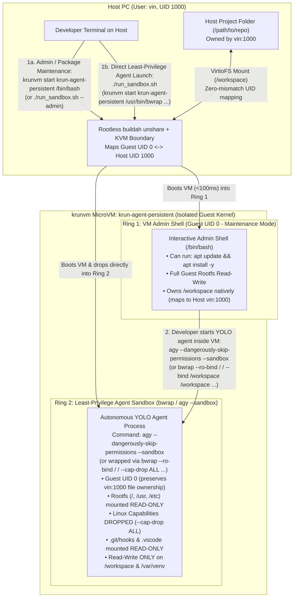

# Industrial Golden Practices: Privilege Separation, Host Protection & Shared Folder Security in `krunvm`

In production AI agent sandboxes (e.g., Kata Containers, Firecracker/libkrun, Cloud Workstation microVMs, and hardened DevContainers), engineering teams must balance three competing requirements:
1. **Guest Flexibility:** Allowing developers or provisioning steps to install system packages (`apt update && apt install`) inside the VM.
2. **Host Protection:** Ensuring a compromised or hallucinating YOLO-mode agent cannot escape to the host or plant malicious execution vectors (`setuid` binaries, modified `.bashrc`, `.git/hooks`, or `.vscode/tasks.json`) on the host filesystem.
3. **Seamless Folder Sharing:** Avoiding UID/GID "permission denied" errors or root-owned file pollution on the shared `/workspace` folder between the host PC and the microVM.

This document outlines the industrial architecture for balancing all three using **`krunvm` + `buildah unshare` + `bubblewrap` (`bwrap`)**.

---

## 1. How UID Mapping Works Between Host and `krunvm` (Why `root` in VM $\neq$ `root` on Host)

Because `krunvm` runs inside `buildah unshare` (a rootless Linux user namespace on the host), Linux kernel UID translation is active at the hypervisor boundary:

| Identity Inside MicroVM | Actual Identity on Host PC | Can it modify Host OS? | File Ownership on Shared `/workspace` |
| :--- | :--- | :--- | :--- |
| **`root` (UID 0)** | **Host User (e.g., `vin`, UID 1000)** | **No** (Unprivileged host user + KVM hardware boundary) | Owned cleanly by **`vin:vin` (1000:1000)** |
| **`ubuntu` (UID 1000)** | **Subordinate UID `100999`** | **No** | Owned by `100999:100999` (causes permission mismatches on host!) |

### Key Architectural Insight
In rootless microVMs (`krunvm`, Podman Machine, Lima), **guest `UID 0` (`root`) *is* your unprivileged host user (`UID 1000`)**:
* If a process runs as `UID 1000` (`ubuntu`) inside the microVM and writes a file to `/workspace`, your host PC sees that file owned by subordinate UID `100999`—meaning your host IDE and `git` will not own the files the agent creates, and `ubuntu` cannot edit files created by `vin` without brittle `chmod 777` or POSIX ACL workarounds.
* Conversely, when a process runs as `UID 0` inside the microVM, every file it writes to `/workspace` is natively owned by `vin:vin` (`1000:1000`) on the host PC, and `apt-get update && apt-get install` works out-of-the-box inside the VM when administrative maintenance is needed.

---

## 2. The Industrial Practice: Two-Ring Privilege Separation Inside the VM

Rather than fighting the `Guest UID 0 <-> Host UID 1000` mapping for `/workspace`, industrial agent sandboxes separate **VM Administration (Ring 1)** from **Agent Execution (Ring 2)** *inside* the microVM using **Bubblewrap (`bwrap`) + Linux Capabilities**:



### Why This Is the Gold Standard
1. **Zero UID Mismatch on `/workspace`:** Because both Ring 1 and Ring 2 execute under Guest UID 0 (which `buildah unshare` maps directly to Host UID 1000), `git`, VS Code, and `agy` on both host and guest read and write `/workspace` with identical ownership.
2. **`apt update` Works When Needed (Ring 1):** In an explicit administrative shell, you have full guest privileges to install system dependencies (`apt update && apt install -y libpq-dev`).
3. **Least-Privilege YOLO Agent Execution (Ring 2):**
   When launching `agy` in YOLO mode, wrapping it in `bwrap` (or running `agy --sandbox`):
   * Mounts `/`, `/usr`, `/etc`, `/bin` as **Read-Only** (`--ro-bind / /`) so the YOLO agent **cannot** run `apt`, modify `/etc/sudoers`, overwrite system binaries, or tamper with telemetry hooks (`/usr/local/bin/export_agy_otel`).
   * Drops all root capabilities (`--cap-drop ALL`, `--no-new-privs`) so even though its numerical UID inside the VM is `0` (preserving `/workspace` file ownership), it has **zero root kernel privileges** (`CAP_SYS_ADMIN`, `CAP_NET_ADMIN`, `CAP_DAC_OVERRIDE`, etc. are all stripped).
   * Mounts `/workspace` and `/var/venv` as **Read-Write** (`--bind /workspace /workspace --bind /var/venv /var/venv`) so the agent can freely edit project code and install Python packages via `uv pip install`.

---

## 3. Industrial Best Practices for Protecting the Shared Folder (`/workspace`)

Even when the microVM is hardware-isolated by KVM, **the shared folder (`/workspace`) is a bridge back to the host**. If an agent modifies a file in `/workspace` that a user or IDE later executes on the host, that crosses the trust boundary.

### 1. Mount Only Target Project Subdirectories (Never `$HOME` or `/`)
Enforced by `setup.sh`. Never share `/`, `/home`, or `$HOME`, as doing so exposes `~/.ssh`, `~/.aws`, `~/.bashrc`, and `~/.config` to the guest.

### 2. Protect Host Execution Vectors Inside `/workspace` (`.git/hooks`, `.vscode`)
If a prompt injection tricks a YOLO agent into writing a malicious script into `/workspace/.git/hooks/post-checkout` or `.vscode/tasks.json`, and you subsequently run `git checkout` or open the folder in VS Code on your **host** machine, that payload would execute on your host.
* **Best Practice:** Mount `.git/hooks` (and optionally `.vscode` / `.idea`) as **read-only** inside the agent's `bwrap` sandbox:
  ```bash
  --ro-bind-try /workspace/.git/hooks /workspace/.git/hooks \
  --ro-bind-try /workspace/.vscode /workspace/.vscode
  ```

### 3. Protect Sandbox Orchestrator Scripts
When mounting a repository that contains its own host launcher scripts (such as `setup.sh`, `run_sandbox.sh`, `.env`, or `scripts/`), mount those files **read-only** inside the Ring 2 `bwrap` sandbox so the guest agent cannot modify scripts that will later be executed on the host:
```bash
--ro-bind-try /workspace/setup.sh /workspace/setup.sh \
--ro-bind-try /workspace/run_sandbox.sh /workspace/run_sandbox.sh \
--ro-bind-try /workspace/.env /workspace/.env
```

### 4. Enforce `nosuid,nodev` Semantics
Shared host mounts must never allow the creation of character/block devices (`nodev`) or setuid binaries (`nosuid`) that could be executed on the host. Running `krunvm` inside rootless `buildah unshare` paired with `bwrap --cap-drop ALL` inherently prevents device node creation and host SUID privilege escalation.

---

## 4. Reference Operating Modes

| Mode | Command Pattern | Guest Capabilities | Rootfs (`/usr`, `/etc`) | `/workspace` & `/var/venv` | `.git/hooks` | Primary Use Case |
| :--- | :--- | :--- | :--- | :--- | :--- | :--- |
| **Default (Ring 2: Least-Privilege Agent)** | `./run_sandbox.sh` | Dropped (`--cap-drop ALL`) | **Read-Only** | **Read-Write** (mapped to Host UID 1000) | **Read-Only** | Running `agy` in YOLO mode, coding, running tests, `uv pip install` |
| **Admin (Ring 1: VM Maintenance)** | `./run_sandbox.sh --admin` | Full Guest VM Root | **Read-Write** | **Read-Write** (mapped to Host UID 1000) | **Read-Write** | Running `apt update && apt install`, OS debugging |
