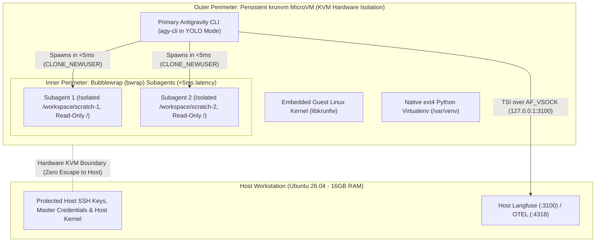

# Architectural Comparison & Migration Evaluation: Canonical Multipass vs. krunvm + Bubblewrap (bwrap)

**Target Environment:** 16 GB RAM, 8-Core CPU, Ubuntu 26.04 LTS  
**Source Repository:** [`Vincentchong123/multipass`](file:///home/vin/ws/20_projects/21_github/Vincentchong123/multipass)  
**Target Architecture:** Hybrid Two-Tier: `krunvm` (Hardware KVM Outer Perimeter) + `bwrap` (Zero-Overhead Subagent Sandboxing)

---

## 1. Executive Summary & Architectural Advisory

This evaluation assesses the viability, trade-offs, and migration path of replacing the Canonical Multipass two-tier provisioning framework with a **hybrid microVM + container sandbox architecture (`krunvm` + `bwrap`)** on a resource-constrained workstation (16 GB RAM, 8 vCPUs) running Ubuntu 26.04 LTS.

> [!WARNING]
> ### ⚠️ DevOps Architectural Warning: Managing Upstream Drift vs. MicroVM Benefits
> - **Packaging & Maintenance on Ubuntu 26.04:** Canonical Multipass is a first-class, natively packaged Ubuntu orchestration tool. In contrast, `krunvm` and its companion C libraries (`libkrunfw`, `libkrun`) require from-source compilation on Ubuntu 26.04 using Rust (`cargo`), GCC, and an unversioned `libclang.so` symlink.
> - **Single-Depth Mount Constraints:** Unlike standard hypervisors or Docker, `krunvm` enforces that guest volume mounts must be direct single-depth root children (e.g. `/workspace`, `/scratch` rather than nested paths like `/mnt/workspace`).

> [!TIP]
> ### 💡 Modern Industry Standard: The "Defense-in-Depth" Sandbox Model
> - **Outer Perimeter (Hardware Virtualization via KVM / `libkrun`):** Enforces a complete hardware boundary around the autonomous AI coding agent ([Antigravity CLI](https://github.com/google-deepmind)). Even if an agent executes arbitrary untrusted shell code that compromises the Linux container namespaces, it cannot break out to the host workstation.
> - **Inner Perimeter (Process Isolation via Bubblewrap / `bwrap`):** Within the microVM, `agy-cli` utilizes native `bwrap` unprivileged user namespaces to isolate subagents in **< 5 ms** with **0 MB memory overhead**, preventing subagents from corrupting the primary agent's virtualenv or secrets.

---

## 2. Two-Tier Defense-in-Depth Architecture (`krunvm` + `bwrap`)



---

## 3. Subagent Sandboxing: Internal `bwrap` vs. Nested `krunvm`

When an autonomous agent inside the persistent sandbox launches subagents for parallel research, test execution, or untrusted code execution, there are two potential isolation paths:

| Dimension | Native `bwrap` Inside `krunvm` (Recommended) | Nested Ephemeral `krunvm` MicroVM |
| :--- | :--- | :--- |
| **Startup Latency** | **< 5 milliseconds** (unprivileged Linux syscalls) | **50 – 100 milliseconds** (boots a fresh kernel) |
| **RAM Footprint (16GB Host)** | **0 MB extra base RAM** (shares guest kernel page cache) | **~30 – 50 MB baseline RAM** per microVM instance |
| **CPU Virtualization Tax** | **0% overhead** (native process execution) | Nested VM-exit/entry context switches via KVM |
| **Concurrency Scale** | Easily spawns 10+ subagents simultaneously | Memory and vCPU contention at 3+ concurrent microVMs |
| **Filesystem Isolation** | Mount namespaces (`--ro-bind / /`, isolated scratch) | Complete OCI rootfs copy on disposable scratch |
| **Host Blast Radius** | **Zero** (protected by outer `krunvm` KVM perimeter) | **Zero** (protected by outer + inner KVM perimeters) |
| **Prerequisites** | `bubblewrap` package installed in container | Nested KVM virtualization (`/dev/kvm` in guest) |

### Key Finding on `krunvm` + `bwrap`
1. **Live Verification:** We verified that `bubblewrap 0.9.0` executes cleanly within `krun-agent-persistent` under unprivileged user namespaces:
   ```bash
   ./run_sandbox.sh bwrap --ro-bind / / --dev /dev --proc /proc --tmpfs /tmp /bin/echo "Hello from bwrap inside krunvm!"
   # Output: Hello from bwrap inside krunvm! (Exit code: 0)
   ```
2. **Optimal Division of Labor:**
   * **`krunvm`** handles the macro-isolation: protecting the host workstation (host SSH keys, personal files, and host Linux kernel).
   * **`bwrap`** handles the micro-isolation: protecting the primary agent from subagent pollution, file overwrites, and process interference in sub-5ms cold starts.

---

## 4. Technical Comparison Matrix: Multipass vs. krunvm

| Evaluation Dimension | Canonical Multipass (Current) | `krunvm` + `bwrap` (Target) |
| :--- | :--- | :--- |
| **Virtualization Backend** | QEMU / KVM (full machine emulation) | `libkrun` (lightweight in-process VMM via KVM) |
| **Guest Environment** | Full Ubuntu OS (kernel + `systemd` PID 1) | OCI Container rootfs (minimal kernel directly to app PID 1) |
| **Boot & Spin-up Latency** | 15 – 30 seconds (cloud-init + OS boot) | **< 100 ms** (Persistent VM) / **< 5 ms** (`bwrap` subagent) |
| **RAM Footprint (16GB Host)** | **Static reservation** (e.g., 2 GB pinned via QEMU) | **Dynamic in-process allocation** (yields RAM back to host) |
| **Idle Memory Overhead** | ~300 – 600 MB (snapd, journald, system services) | **~30 – 50 MB** (only libkrun runtime + target binary) |
| **Provisioning Mechanism** | Cloud-Init (`#cloud-config` in `setup.yaml`) | Containerfiles / Dockerfile builds (`buildah bud`) |
| **Background Daemons / Services** | Supported via standard `systemd` unit files | Not supported natively; requires foreground init |
| **Remote Access & IDE** | Native OpenSSH daemon (`VS Code Remote - SSH`) | Interactive TTY (`run_sandbox.sh`) or port-mapped `sshd` |
| **Filesystem Sharing** | VirtioFS native mount (`--type native`, UID 1000) | VirtioFS host directory mounts (`-v /host:/guest`) |
| **Networking Model** | Bridge / NAT subnet (`VM_IPV4`, host gateway) | TSI (Transparent Socket Impersonation) over `AF_VSOCK` |
| **Telemetry / Host Reverse Route** | Predictable gateway (`http://${HOST_GATEWAY_IP}:4318`) | Zero-bridge TSI loopback mapping (`http://127.0.0.1:3100`) |
| **Ubuntu 26.04 Upstream Support** | **First-class Canonical package** (Snap / APT) | **Build from source** (`libkrunfw`, `libkrun`, `cargo`) |

---

## 5. In-VM Web Browser Support Analysis

A critical requirement for autonomous AI coding agents is in-VM browser capability (for automated verification, end-to-end testing, or web research).

### 5.1 Headless Browsers (Playwright, Puppeteer, Chromium `--headless`)
* **Status:** **Fully Supported & Superior in `krunvm`.**
* **Network & DNS:** Outbound TLS/HTTP requests route seamlessly through `libkrun`'s Transparent Socket Impersonation (TSI) without requiring host network bridge configuration.
* **Cold-Start Advantage:** An AI agent can launch a dedicated microVM or `bwrap` session, execute a Playwright test script, and tear down the environment in milliseconds.
* **Shared Memory (`/dev/shm`):** `krunvm` automatically mounts a `tmpfs` volume at `/dev/shm` inside the microVM, preventing Chromium `SIGBUS` tab crashes.

### 5.2 Interactive GUI Desktop Browsers (Display Window on Host)
* **Status:** **Not Native to `krunvm`, requires Display Sockets or `muvm`.**
* **The Display Gap:** `krunvm` is a CLI process supervisor; it does not provision a virtual display adapter or route window buffers to the host desktop by default.
* **Architectural Options:**
  1. **Socket Bridging:** Mount the host X11 socket (`-v /tmp/.X11-unix:/tmp/.X11-unix -e DISPLAY=$DISPLAY`) and permit access via `xhost +local:`.
  2. **`muvm` Integration:** For native desktop GUI applications, the `libkrun` community created [`muvm`](https://github.com/AsahiLinux/muvm), which bridges Wayland, X11, and `virtio-gpu` (Virgl/Venus) with hardware acceleration.

---

## 6. Migration Impact on the Codebase

Migrating from the Multipass engine to `krunvm` + `bwrap` requires the following architectural refactoring:

| Existing Component | Status | Required Replacement / Migration Action |
| :--- | :--- | :--- |
| [`setup.yaml`](file:///home/vin/ws/20_projects/21_github/Vincentchong123/multipass/setup.yaml) | **Obsolete** | Replaced with an OCI `Containerfile` built using `buildah`. |
| [`setup.sh`](file:///home/vin/ws/20_projects/21_github/Vincentchong123/multipass/setup.sh) | **Refactored** | Replaces Multipass commands with `krunvm create` and single-depth volume mounts. |
| `.env.host` | **Modified** | Configures `VM_NAME`, `VM_CPUS`, `VM_MEMORY`, and single-depth `/workspace` mount. |
| `multipass-ro-mounts.service` | **Incompatible** | Mount flags handled at creation time or managed via internal `bwrap` mounts. |
| Host Telemetry Bridge | **Simplified** | Guest connects directly to `http://127.0.0.1:3100` via TSI, avoiding gateway IP lookups. |

---

## 7. Strategic Verdict & Final Architecture

1. **Retain Canonical Multipass if:**
   * Your primary workflow strictly depends on **VS Code Remote - SSH**, background `systemd` daemon services, and zero-compilation Ubuntu LTS stability.
   * You prefer allocating a fixed 2 GB RAM slice to the VM regardless of host memory contention.

2. **Adopt `krunvm` + `bwrap` if:**
   * Your priority on this 16 GB RAM workstation is **memory reclamation** (dynamic heap allocation yielding unused RAM back to the host) and **sub-second task execution**.
   * You want the **ultimate agentic pairing**: an outer persistent `krunvm` microVM providing unbreakable KVM hypervisor isolation from your host, combined with Antigravity CLI's native `bwrap` launching subagents in < 5 ms with zero RAM bloat.
