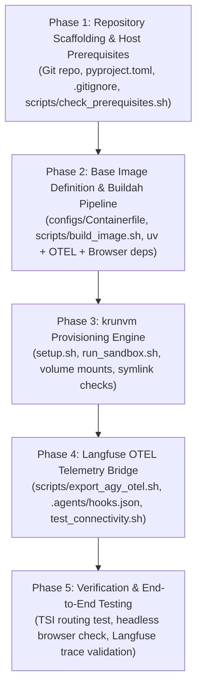

# Implementation Plan: krunvm Agent-Isolated Sandbox with Host Langfuse OTEL Integration

**Target Repository:** [`Vincentchong123/krunvm`](file:///home/vin/ws/20_projects/21_github/Vincentchong123/krunvm)  
**Reference Architecture:** [`Vincentchong123/multipass`](file:///home/vin/ws/20_projects/21_github/Vincentchong123/multipass)  
**Host Environment:** 16 GB RAM, 8 Cores, Ubuntu 26.04 LTS  

---

## 1. Architectural Foundation & DevOps Guardrails

> [!WARNING]
> ### ⚠️ DevOps Architectural Warning: Managing MicroVM Drift & Build Isolation
> - **Avoid Local Absolute Paths:** All mount paths and binary resolutions must reference project-relative roots or standard Linux environment variables (`$HOME`, `$XDG_RUNTIME_DIR`), avoiding hardcoded `/home/vin/...` paths in tracked configs.
> - **Immutable Base Images vs. Mutable Shell Drifts:** In Multipass, provisioning relied on Cloud-Init modifying a running VM. In `krunvm`, we must adhere to **Twelve-Factor App and immutable container principles**: the guest OS, tools (`uv`, Python, headless browser dependencies), and OTEL exporters are baked into an immutable OCI image via `buildah`, while only mutable project workspaces are mounted at runtime.
> - **Decoupled Secret Boundaries:** Never mount host `.env` or master developer credentials into the microVM. Maintain strict separation between `.env.host` (orchestrator settings) and `.env.sandbox` (ephemeral agent tokens).

> [!TIP]
> ### 💡 Modern Industry Standard
> - Use **Buildah** to produce an unprivileged OCI rootfs that runs as `UID 1000:1000` (matching the host developer account) to avoid the "Docker permission tax".
> - Exploit `libkrun`'s **Transparent Socket Impersonation (TSI)** over `AF_VSOCK` to eliminate bridge subnets and route agent telemetry directly to host Langfuse (`:3100`) and OpenTelemetry (`:4318`) endpoints.

---

## 2. Target Repository Architecture

```text
/home/vin/ws/20_projects/21_github/Vincentchong123/krunvm/
├── .agents/
│   ├── hooks.json                      # Antigravity CLI PostToolUse & Stop OTEL export hooks
│   └── plans/                          # Agent decision logs & execution manifests
├── configs/
│   └── Containerfile                   # Base OCI image definition (Ubuntu 24.04/26.04 + uv + OTEL + Browser deps)
├── docs/
│   ├── multipass-vs-krunvm-bwrap-comparison.md # Prior trade-off matrix & bwrap architecture
│   └── plans/
│       └── krunvm-implementation-plan.md # Persistent project copy of this plan
├── scripts/
│   ├── build_image.sh                  # Buildah wrapper building localhost/krun-agent-sandbox:latest
│   ├── check_prerequisites.sh          # Pre-flight KVM, buildah, libkrun, and krunvm health checks
│   ├── export_agy_otel.sh              # Host-bound OTEL telemetry export script
│   ├── export_agy_otel_to_langfuse.py  # Python OTLP HTTP forwarder
│   ├── test_connectivity.sh            # In-guest network and host Langfuse connectivity tester
│   └── test_smoke.sh                   # End-to-end telemetry pipeline verification
├── .env.example                        # Host & MicroVM configuration template
├── .env.host                           # Host local runtime configuration (untracked)
├── .env.sandbox.example                # Decoupled agent tokens & sandbox env template
├── .gitignore                          # Strict exclusions for credentials, venvs, and build artifacts
├── .pre-commit-config.yaml             # Pre-commit quality gates (Ruff, TruffleHog, ShellCheck, Yamllint)
├── pyproject.toml                      # Python dependencies & linter standards
├── README.md                           # Comprehensive documentation & architecture guide
├── run_sandbox.sh                      # Quick-launch execution wrapper (interactive or command exec)
└── setup.sh                            # Idempotent microVM creation, volume mount, and hydration engine
```

---

## 3. Subsystem Specifications

### Subsystem 1: Containerfile & Immutable OCI Base Image (`configs/Containerfile`)
- **Base OS:** `ubuntu:24.04` (or `26.04`).
- **User Parity:** Create `ubuntu` user (`UID 1000`, `GID 1000`) matching host permissions.
- **System Utilities:** `git`, `curl`, `ca-certificates`, `build-essential`, `jq`, `iproute2`.
- **Headless Browser Dependencies:** `libnss3`, `libnspr4`, `libatk1.0-0`, `libatk-bridge2.0-0`, `libcups2`, `libdrm2`, `libxcomposite1`, `libxdamage1`, `libxfixes3`, `libxrandr2`, `libgbm1`, `libpango-1.0-0`, `libasound2t64` (enabling seamless Playwright/Chromium headless automation).
- **Astral `uv` Toolchain:** Install `uv` binary to `/usr/local/bin` and initialize a native ext4 Python 3.12 virtual environment at `/var/venv` (owned by `ubuntu:ubuntu`).
- **Pre-baked OTEL Environment:** Pre-provision `/home/ubuntu/.gemini/antigravity-cli/hooks_env/.venv` with `opentelemetry-sdk`, `opentelemetry-exporter-otlp-proto-http`, and `python-dotenv`.

### Subsystem 2: Orchestration & Provisioning Engine (`setup.sh`)
Refactored from the 600-line Multipass script to leverage `krunvm`:
1. **Pre-flight Checks:**
   - Verify `/dev/kvm` read/write permissions.
   - Verify `buildah` and `krunvm` binaries exist on `$PATH`.
   - Security Golden Rule: Forbid mounting `/`, `/home`, or `$HOME`.
   - Audit out-of-tree / absolute symlinks in mounted project paths.
2. **Image Build / Verification:**
   - Auto-trigger `scripts/build_image.sh` if `localhost/krun-agent-sandbox:latest` does not exist.
3. **MicroVM Instance Management:**
   - Check `krunvm list`.
   - If instance exists in stopped state: ready to start.
   - If instance does not exist: create with strict resource limits:
     ```bash
     krunvm create localhost/krun-agent-sandbox:latest \
         --name "$VM_NAME" \
         --cpus "$VM_CPUS" \
         --mem "$VM_MEMORY" \
         --workdir "$PRIMARY_VM_DIR" \
         -v "$HOST_MOUNT_DIR:$VM_MOUNT_DIR:rw" \
         -v "/dev/shm:/dev/shm" \
         $(generate_ro_volume_flags)
     ```
4. **Decoupled Sandbox Configuration:**
   - Transfer/mount `.env.sandbox` directly to `/home/ubuntu/.gemini/antigravity-cli/.env` (`chmod 600`).
   - Inject global telemetry hook config into `/home/ubuntu/.gemini/config/hooks.json`.

### Subsystem 3: Host Langfuse & OpenTelemetry Bridge
- **TSI Socket Networking:** `libkrun`'s Transparent Socket Impersonation automatically maps guest socket calls to host sockets over `AF_VSOCK`.
- **Target Addressing:**
  - Guest can address host services via `127.0.0.1` or the host's primary physical IP.
  - The setup script probes `http://127.0.0.1:${HOST_LANGFUSE_PORT}/api/public/health` from inside the guest.
- **Antigravity Hooks Integration:**
  - `.agents/hooks.json` maps `PostToolUse` and `Stop` to execute `export_agy_otel`.
  - `export_agy_otel.sh` invokes `export_agy_otel_to_langfuse.py` using the dedicated hooks virtualenv.

### Subsystem 4: Agent Isolation & Blast Radius Controls
- **Hypervisor Boundary:** Linux KVM isolation ensures guest shell code cannot compromise the host kernel.
- **Filesystem Segregation:**
  - Target workspace mounted as `:rw`.
  - Notes/Reference data mounted as `:ro`.
  - Host master SSH keys, AWS/GCP credentials, and parent directories are completely inaccessible.
- **Resource Clamping:** On a 16 GB machine, hard caps (`--cpus 4 --mem 4096`) prevent an autonomous agent runaway process from OOM-crashing the host workstation.
- **Subagent Execution Model (In-VM Bubblewrap):** Subagents launched by Antigravity CLI are isolated inside the persistent microVM using native unprivileged **Bubblewrap (`bwrap`)** user namespaces (<5ms cold start, 0 MB memory overhead). Nested microVM instances are explicitly avoided to eliminate hypervisor nesting overhead and VM locking conflicts.

---

## 4. Phase-by-Phase Implementation Roadmap



### Phase 1: Repository Scaffolding & Host Prerequisites
- Initialize standard repository structure, `.gitignore`, `.editorconfig`, `.pre-commit-config.yaml`, and `pyproject.toml`.
- Create `scripts/check_prerequisites.sh` to validate KVM access, `buildah`, `cargo`, and `krunvm`.
- Create canonical configuration templates: `.env.example` and `.env.sandbox.example`.

### Phase 2: Base Image Definition & Buildah Pipeline
- Author `configs/Containerfile` incorporating:
  - Ubuntu noble base with UID 1000 `ubuntu` user.
  - Astral `uv` installation.
  - Python 3.12 virtualenv at `/var/venv`.
  - Shared headless browser libraries (Chromium / Playwright support).
  - Pre-installed OpenTelemetry exporter packages.
- Author `scripts/build_image.sh` to deterministically compile the OCI image using `buildah`.

### Phase 3: krunvm Provisioning Engine
- Port the robust pre-flight guards from [`setup.sh`](file:///home/vin/ws/20_projects/21_github/Vincentchong123/multipass/setup.sh):
  - Security root mount check.
  - Out-of-tree symlink detector.
  - Volume mount parser (`host:guest[:ro|:rw]`).
- Implement `setup.sh` to idempotently create and configure the `krunvm` microVM instance.
- Implement `run_sandbox.sh` to allow seamless interactive developer access (`krunvm start <name> /bin/bash`) or one-shot command execution.

### Phase 4: Langfuse OTEL Telemetry Bridge
- Port `export_agy_otel.sh` and `export_agy_otel_to_langfuse.py` from `Vincentchong123/local-infra`.
- Configure `.agents/hooks.json` for Antigravity CLI post-tool tracking.
- Create `scripts/test_connectivity.sh` to verify TSI socket forwarding from guest to host Langfuse (`:3100`) and OTLP collector (`:4318`).

### Phase 5: Verification & End-to-End Testing
- Execute dry-run provisioning in `krunvm`.
- Verify memory consumption on the 16 GB host before, during, and after execution.
- Run a headless browser test script inside the microVM to ensure no `/dev/shm` crashes occur.
- Trigger agent tool actions and verify that spans appear in the host Langfuse dashboard.
