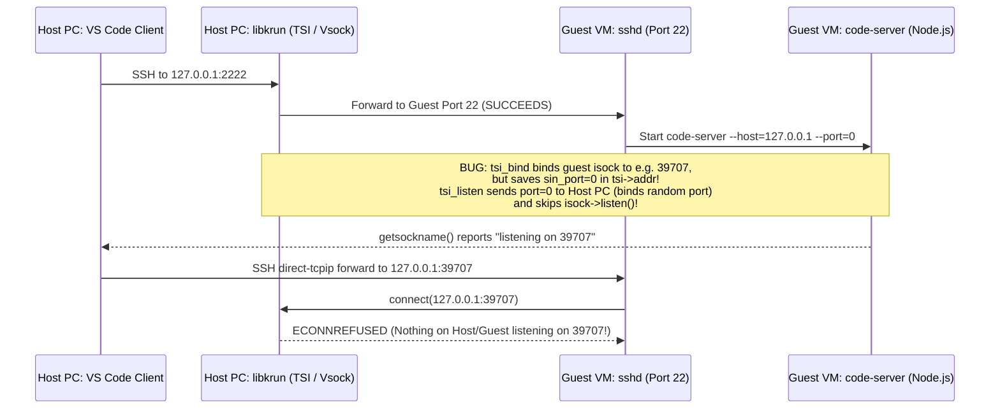

# Implementation Plan: Fix VS Code Remote-SSH for `krunvm` (`krun-act-runner`)

## Goal Description

Enable reliable VS Code Remote-SSH connections from the Host PC (`Host krun-act-runner` on `127.0.0.1:2222`) into this `krunvm` MicroVM (`sshd` on port `22`), and provide heavily commented Host PC setup/verification scripts in `/shared_dir_host_vm/vm2host` (`~/ws/github/VincentChong123/krunvm/shared_dir_host_vm/vm2host` on the Host PC).

---

## Root Cause Analysis (Why VS Code Failed Previously)

Our kernel and socket diagnostics pinpointed **two specific `krunvm` (`AF_TSI`) bugs** that caused VS Code Remote-SSH to fail:



1. **Kernel Bug in `libkrunfw` `AF_TSI` (`tsi_bind` / `tsi_listen`) when `port=0` is used:**
   - The `krunvm` guest kernel boots with `tsi_hijack` (`AF_TSI` Transparent Socket Impersonation).
   - When `code-server` runs with `--port=0`, Node.js calls `bind("127.0.0.1", 0)` and `listen()`.
   - Disassembly of `tsi_bind` (`0xffffffff81ba8dc3`) and `tsi_listen` (`0xffffffff81ba80f0`) from `/proc/kcore` showed that `tsi_bind` binds the internal guest socket (`isock`) to `127.0.0.1:0` (which allocates e.g. `39707`), **but saves the caller's original `sockaddr` with `sin_port = 0` into `tsi->addr` (`0x310(%r13)`)**.
   - When `tsi_listen` runs, it sends `TSI_LISTEN` (`0x405`) with `sin_port = 0` to `libkrun` on the Host PC, which binds a *different* random port on the Host PC and returns `0`, causing `tsi_listen` to skip `isock->ops->listen()`.
   - When `code-server` calls `getsockname()`, `tsi_getname` returns `isock`'s port (`39707`), which is not actually listening anywhere! When `sshd` attempts to forward to `127.0.0.1:39707`, it gets `connect to 127.0.0.1 port 39707 failed: Connection refused`.
   - **Proof:** Binding `127.0.0.1` to any **non-zero** port (e.g. `38234`) or binding an **`AF_UNIX`** domain socket (`--socket-path`) succeeds 100% of the time in both Python and VS Code's `node` binary.

2. **`ss -tlpn` False Negatives under `AF_TSI`:**
   - Because `AF_TSI` sockets live in `PF_TSI` rather than standard `PF_INET` (`/proc/net/tcp` has `0` entries), `ss -tlpn | grep :22` always fails inside `krunvm`.
   - This caused [check_vscode_health.sh](file:///shared_dir_host_vm/ssh/check_vscode_health.sh) to falsely report `[FAIL] sshd is NOT listening on port 22!` and caused [setup_vscode.sh](file:///shared_dir_host_vm/ssh/setup_vscode.sh) to spawn duplicate `sshd` daemons.

---

## Proposed Changes

### Component 1: Guest VM `AF_TSI` `port=0` Fix & SSH Daemon Scripts (`/shared_dir_host_vm/ssh/`)

#### [NEW] [libkrun_tsi_fix.c](file:///shared_dir_host_vm/ssh/libkrun_tsi_fix.c)
Create a small, zero-overhead C shared library compiled to `/usr/local/lib/libkrun_tsi_fix.so` and loaded via `/etc/ld.so.preload`:
- Intercepts glibc `bind(int sockfd, const struct sockaddr *addr, socklen_t addrlen)`.
- Only acts when `addr->sa_family` is `AF_INET` or `AF_INET6`, the socket type (`SO_TYPE`) is `SOCK_STREAM`, and `sin_port == 0` (`sin6_port == 0`).
- Replaces `sin_port = 0` with an explicit non-zero port chosen from `32768..60999` (seeded by PID, monotonic clock, and an atomic counter, retrying up to 100 times if `EADDRINUSE`).
- Leaves all other `bind()` calls (including `sshd` port `22`, `AF_UNIX`, `SOCK_DGRAM`, etc.) completely untouched.
- This fixes `code-server --port=0` as well as all VS Code child services (`McpGatewayService`, language servers, debuggers, Jupyter kernels) that bind to `127.0.0.1:0`.

---

#### [MODIFY] [setup_vscode.sh](file:///shared_dir_host_vm/ssh/setup_vscode.sh)
- Compile `/shared_dir_host_vm/ssh/libkrun_tsi_fix.c` into `/usr/local/lib/libkrun_tsi_fix.so` and register it in `/etc/ld.so.preload`.
- Install `/usr/local/bin/ensure-sshd.sh` and hook it into `/etc/bash.bashrc` (alongside the existing `ensure-dockerd.sh`) so `/dev/ptmx`, `/etc/ld.so.preload`, and `sshd` are automatically ensured whenever the `krunvm` VM starts.
- Replace the broken `ss -tlpn | grep :22` check with an `AF_TSI`-aware check (verifying the `sshd` listener process, its `/proc/<pid>/fd` socket inode, and a live round-trip SSH banner test against `127.0.0.1:2222`).

---

#### [MODIFY] [check_vscode_health.sh](file:///shared_dir_host_vm/ssh/check_vscode_health.sh)
- Update Check 1 (`SSH Daemon Status`) to inspect `sshd` listener processes, `/proc/<pid>/fd` sockets, and test the live round-trip SSH banner via `127.0.0.1:2222`.
- Add a check verifying `/usr/local/lib/libkrun_tsi_fix.so` is active in `/etc/ld.so.preload` and run a live `port=0` loopback self-test (`bind('127.0.0.1', 0)` + `connect()`).

---

### Component 2: Host PC Setup & Verification Scripts (`/shared_dir_host_vm/vm2host/`)

> [!IMPORTANT]
> Because `/shared_dir_host_vm` inside the VM is mounted from `~/ws/github/VincentChong123/krunvm/shared_dir_host_vm` on the Host PC, all Host PC scripts will be written to `/shared_dir_host_vm/vm2host/` with detailed comments explaining every step.

#### [NEW] [setup_host_vscode_ssh.sh](file:///shared_dir_host_vm/vm2host/setup_host_vscode_ssh.sh)
A heavily commented script to be executed on the **Host PC** (`~/ws/github/VincentChong123/krunvm/shared_dir_host_vm/vm2host/setup_host_vscode_ssh.sh`):
1. **SSH Client Configuration (`~/.ssh/config`):**
   - Verifies or updates the `Host krun-act-runner` block (`HostName 127.0.0.1`, `Port 2222`, `User root`, `IdentityFile ~/.ssh/id_ed25519`, `StrictHostKeyChecking no`, `UserKnownHostsFile /dev/null`) and adds recommended stability options (`ServerAliveInterval 15`, `ServerAliveCountMax 6`, `ControlMaster no`, `ExitOnForwardFailure no`).
2. **SSH Public Key Sync:**
   - Reads `~/.ssh/id_ed25519.pub` and ensures it is present in `~/ws/github/VincentChong123/krunvm/shared_dir_host_vm/vm2host/id_ed25519.pub` and synced to the VM's `/root/.ssh/authorized_keys` via SSH if reachable.
3. **VS Code User Settings (`~/.config/Code/User/settings.json`):**
   - Safely backs up `settings.json` and uses Python/jq to set:
     - `"remote.SSH.remoteServerListenOnSocket": true` (uses `AF_UNIX` socket forwarding as an additional fast path alongside our `port=0` fix)
     - `"remote.SSH.connectTimeout": 60`
     - `"remote.SSH.RemotePlatform": { "krun-act-runner": "linux" }` (skips redundant platform detection round-trips)
4. **Kills stale local VS Code SSH multiplexers** targeting `127.0.0.1:2222`.

---

#### [NEW] [test_host_to_vm_ssh.sh](file:///shared_dir_host_vm/vm2host/test_host_to_vm_ssh.sh)
A heavily commented diagnostic and connection launcher script to be executed on the **Host PC**:
1. Tests TCP connectivity to `127.0.0.1:2222` and checks the `SSH-2.0-OpenSSH` banner.
2. Tests passwordless key authentication (`ssh krun-act-runner echo OK`).
3. Triggers `/shared_dir_host_vm/ssh/check_vscode_health.sh` inside the VM over SSH.
4. Tests live SSH local TCP port forwarding (`ssh -L ...`) to a `port=0` listener inside the VM, proving VS Code's forwarding channel works end-to-end.
5. Optionally launches VS Code connected directly to the VM (`code --remote ssh-remote+krun-act-runner /shared_dir_host_vm`) when passed `--launch`.

---

## Verification Plan

### Automated Tests (Inside the VM)
1. Run `/shared_dir_host_vm/ssh/setup_vscode.sh` and verify `/usr/local/lib/libkrun_tsi_fix.so` compiles cleanly and is active in `/etc/ld.so.preload`.
2. Re-run our Python and VS Code `node` `listen(0, "127.0.0.1")` tests to verify that `port=0` now binds a valid non-zero port and accepts `127.0.0.1` connections without `ECONNREFUSED`.
3. Run `/shared_dir_host_vm/ssh/check_vscode_health.sh` and verify all health checks pass.
4. Run `bash -n` syntax validation on all scripts in `/shared_dir_host_vm/ssh/` and `/shared_dir_host_vm/vm2host/`.

### Manual Verification (On the Host PC)
1. On the Host PC, run:
   ```bash
   ~/ws/github/VincentChong123/krunvm/shared_dir_host_vm/vm2host/setup_host_vscode_ssh.sh
   ~/ws/github/VincentChong123/krunvm/shared_dir_host_vm/vm2host/test_host_to_vm_ssh.sh --launch
   ```
2. Verify VS Code Remote-SSH connects to `krun-act-runner` and opens the integrated terminal cleanly.
